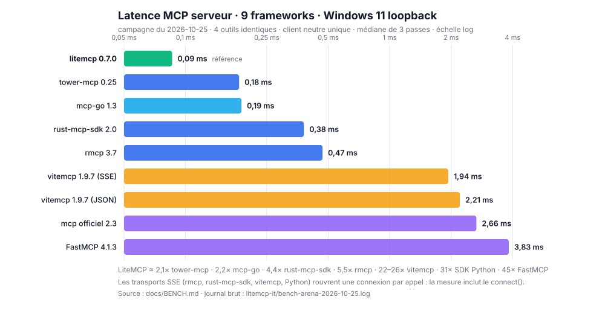

# Banc MCP — méthode, chiffres et limites

> Règle de la maison : **jamais d'adjectif sans chiffre.** Tout ce qui suit est
> reproductible depuis ce dépôt (`examples/bench_backends`, `examples/slo`) et depuis
> `litemcp-it` (client neutre, serveurs de démonstration, campagne et agrégation).

Campagne de référence : **2026-10-25**, Windows 11, `rustc 1.99.1`, loopback, 9 frameworks MCP
(un serveur de démo identique construit avec chacun), mis à jour le jour même. Journal brut : `litemcp-it/bench-arena-2026-10-25.log`.



---

## 1. Ce qui est mesuré

| Métrique | Définition exacte |
|---|---|
| **keep-alive (moy)** | temps `write` du POST → fin de lecture de **la réponse complète** à un `tools/call`, sur une connexion établie ; moyenne sur 2 000 appels après 200 d'échauffement |
| **p50 / p99** | mêmes mesures triées, médiane et 99ᵉ centile (le p99 est ce que l'agent ressent sur les appels lents) |
| **connexions réutilisées** | nombre d'appels où la connexion TCP a pu servir une seconde requête (`Content-Length` + flux clos) sur 2 000 |
| **neuves (conn/s)** | 300 `connect()` + requête + réponse, en série, sans réutilisation |
| **mémoire** | `WorkingSet` du processus qui écoute (+ processus enfants), mesuré **après** la campagne, soit ≈6 900 requêtes par serveur |

Le client ne fait aucune supposition sur le serveur : il accepte les trois styles de réponse
rencontrés en pratique — `Content-Length`, SSE encadré en `chunked`, fermeture de connexion.

## 2. Le dispositif

- **Un seul client**, en Rust (`litemcp-it/examples/bench_remote.rs`) : ni le client officiel
  LiteMCP, ni celui du framework testé. Il envoie le même corps JSON-RPC à tout le monde.
- **Le même serveur de démonstration partout** : 4 outils (`echo`, `counter` avec état,
  `divide` avec erreur métier, `analyze` avec schéma), mêmes sémantiques, réécrits dans
  l'API de chaque framework.
- **9 implémentations**, versions à jour au 2026-10-25 : LiteMCP 0.7.0, tower-mcp 0.25.0,
  mcp-go 1.3.0 (Go), rust-mcp-sdk 2.0.0, rmcp 3.7.0 (SDK Rust officiel), vitemcp 1.9.7
  (TypeScript, deux transports), mcp 2.3.0 (SDK Python officiel), FastMCP 4.1.3 (Python).
- **3 passes alternées** par serveur, ordre identique, machine au repos entre les mesures
  (drainage du pool de ports éphémères).
- **Deux modes** : `bare` (un `tools/call` nu, protocole stateless) et `strict`
  (en-têtes `MCP-Protocol-Version: 2026-07-28`, `Mcp-Method`, `Mcp-Name` + `_meta`), imposé
  par `rmcp` et `rust-mcp-sdk` qui refusent un appel sans session.

## 3. Résultats — keep-alive

| # | Framework (démo 4 outils) | Langage / version | Mode | moy (ms) | p50 | p99 | Réutilisées | Neuves (conn/s) |
|---|---|---|---|---|---|---|---|---|
| 🥇 | **LiteMCP** | Rust 0.7.0 | bare | **0,075–0,091** | 0,064–0,084 | **0,25–0,29** | **2000/2000** | 1 249–1 729 |
| 🥈 | tower-mcp | Rust 0.25.0 | bare | 0,162–0,186 | 0,129–0,152 | 0,90–1,28 | 2000/2000 | 1 167–1 215 |
| 🥉 | mcp-go | Go 1.3.0 | bare | 0,164–0,484 | 0,129–0,204 | 1,02–5,23 | 2000/2000 | 819–1 739 |
| 4 | rust-mcp-sdk | Rust 2.0.0 | strict | 0,306–0,412 | 0,263–0,363 | 1,26–1,58 | 0/2000 | 953–1 555 |
| 5 | rmcp (SDK officiel) | Rust 3.7.0 | strict | 0,341–0,589 | 0,272–0,441 | 1,72–2,62 | 0/2000 | 990–1 759 |
| 6 | vitemcp (SSE) | TypeScript 1.9.7 | bare | 1,72–2,46 | 1,56–1,94 | 4,7–8,0 | 0/2000 | 342–609 |
| 7 | vitemcp (JSON) | TypeScript 1.9.7 | bare | 1,31–2,25 | 1,14–1,91 | 3,5–8,0 | 0/2000 | 369–596 |
| 8 | mcp (SDK officiel) | Python 2.3.0 | bare | 2,55–2,88 | 2,05–2,24 | 6,3–8,5 | 0/2000 | 237–346 |
| 9 | FastMCP | Python 4.1.3 | bare | 3,57–4,01 | 3,05–3,38 | 6,9–9,4 | 0/2000 | 204–234 |

Médiane des 3 passes, écart avec LiteMCP : **×2,1** tower-mcp · **×2,2** mcp-go ·
**×4,4** rust-mcp-sdk · **×5,5** rmcp · **×22,5** vitemcp SSE · **×25,7** vitemcp JSON ·
**×30,9** SDK Python · **×44,6** FastMCP.

## 4. Résultats — mémoire et binaire

| Framework | WorkingSet après ≈6 900 req. | Binaire (release, non strippé) |
|---|---|---|
| **LiteMCP** | **5,1 Mo** | **0,81 Mo** (démo 4 outils) |
| rust-mcp-sdk | 8,5 Mo | 6,70 Mo |
| rmcp | 9,5 Mo | 5,37 Mo |
| mcp-go | 58,2 Mo | 12,60 Mo |
| mcp Python | 79,9 Mo | n/a (interprété) |
| FastMCP | 113,4 Mo | n/a (interprété) |
| tower-mcp | 144–183 Mo ⚠ | 5,50 Mo |
| vitemcp (JSON / SSE) | 191,2 / 191,7 Mo | n/a (interprété) |

⚠ **tower-mcp croît avec le volume de requêtes** : 5,8 Mo à froid, 13,9 Mo après 350
requêtes, 144–183 Mo après ≈7 000 — croissance reproduite deux fois. C'est un fait de
mesure, pas une accusation : à vérifier chez soi avant un service longue durée.

**Records de la campagne (médianes)** : latence **×2,1** (tower-mcp), p99 **×3,8**,
mémoire **×1,7** (rust-mcp-sdk), binaire **×6,8** (tower-mcp) — LiteMCP premier sur les
quatre axes mesurés, et à égalité sur la réutilisation de connexion.

## 4 bis. Où passent les 0,08 ms — le plancher de la plateforme

Question légitime : peut-on descendre plus bas ? Mesure de contrôle avec
`litemcp-it/examples/bench_floor` — un **écho TCP nu** (le serveur relit 128 octets et les
réécrit, sans HTTP, sans JSON, sans parsing), en deux processus, même machine :

| Mesure | moy | p50 | p99 |
|---|---|---|---|
| Écho TCP nu (plancher de la plateforme) | **0,060–0,067 ms** | 0,049–0,064 ms | 0,13–0,15 ms |
| LiteMCP `tools/call` (HTTP + JSON-RPC + validation + handler) | **0,075–0,091 ms** | 0,064–0,084 ms | 0,25–0,29 ms |
| **Surcoût applicatif de LiteMCP** | **+12 à +28 µs** | | |

Autrement dit : sur ce Windows en loopback, **70 à 80 % du chiffre est le transport**, pas la
lib. LiteMCP se situe à 15–30 µs du plancher absolu de la machine — il n'y a pas 0,05 ms à
récupérer dans le code, parce que le système en coûte déjà 0,06. La campagne Linux du
2026-10-24 (0,031–0,033 ms) mesure exactement le même serveur sur une pile réseau dont le
plancher est plus bas.

Leviers testés et **écartés par la mesure** : `TCP_NODELAY` (déjà activé dans la lib ; on/off
donne 0,059–0,064 vs 0,060–0,069 — dans le bruit) et priorité `High` + affinité disjointe
serveur/client (0,077–0,098 ms contre 0,082–0,089 en baseline — aucun gain reproductible).

**Et un transport WebSocket ?** Mesuré aussi (`litemcp-it/examples/bench_ws`, `tungstenite` 0.30,
écho d'une trame binaire de 128 o, deux processus, même machine) :

| Plancher, 2 processus, loopback Windows | moy | p50 | p99 |
|---|---|---|---|
| TCP nu | **0,060–0,067 ms** | 0,049–0,064 | 0,13–0,15 |
| WebSocket (trame binaire 128 o) | 0,065–0,082 ms | 0,057–0,075 | 0,16–0,26 |
| LiteMCP — `tools/call` HTTP + JSON-RPC | 0,075–0,091 ms | 0,064–0,084 | 0,25–0,29 |
| **Socket local** (named pipe Windows, `bench_pipe`) | **0,032–0,037 ms** | 0,029–0,032 | 0,09–0,11 |

Le WebSocket rend **5 à 10 µs** (≈10 %) au HTTP — le coût des en-têtes et du `Content-Length` —
mais il ne descend **jamais** sous l'écho TCP nu : le plancher reste le même. **Le socket local,
lui, divise le plancher par deux** : il ne traverse pas la pile TCP, et un aller-retour de
128 octets y coûte 0,032–0,037 ms contre 0,060–0,067 en TCP. Sur cette machine, c'est le seul
transport qui amène sous 0,05 ms.

Contrepartie : ni les named pipes Windows ni les sockets Unix ne sont des transports MCP
(la spec 2026-07-28 définit stdio et Streamable HTTP). Un serveur MCP sur socket local
gagnerait ~0,04 ms mais sortirait de la conformité, de la traversée des proxys et de la
comparabilité avec les huit autres serveurs — et stdio, le transport local standard de MCP,
est déjà un tube. Ce n'est donc pas le transport qu'il faut changer pour la vitrine ; c'est
la machine (Linux) pour la mesure, ou rien.


## 4 ter. La queue de distribution — et le « temps réel »

Un `tools/call` LiteMCP mesuré sur 2 000 appels, trois passes, même machine :

| | moy | p50 | p99 | p99,9 | **max** |
|---|---|---|---|---|---|
| `tools/call` keep-alive | 0,080–0,085 ms | 0,063–0,071 | 0,197–0,243 | 0,64–0,97 | **1,03–1,17 ms** |

Toute la distribution tient sous **1,2 ms**, et 99,9 % sous 1 ms. Rapporté aux budgets
« temps réel » courants (loopback, même machine) :

| Budget | Ce que LiteMCP laisse | Verdict |
|---|---|---|
| Frame 60 fps — 16,7 ms | ~200 appels au mean, ~68 au p99 | large |
| Frame 120 fps — 8,3 ms | ~100 appels au mean, ~34 au p99 | confortable |
| Tampon audio 128 échantillons à 48 kHz — 2,67 ms | ~32 appels au mean, ~11 au p99 | viable, mais un pic à 1,2 ms mange la moitié du tampon |
| Boucle de contrôle 1 kHz — 1 ms | ~12 appels au mean, ~4 au p99 | **limite** : le max observé (1,17 ms) dépasse la période |
| « Hard real-time » (< 1 ms garanti), HFT | — | **non** : Windows n'offre aucune garantie de ce type |

Ce qui domine n'est jamais le transport : un appel d'outil piloté par un agent LLM coûte
300–3 000 ms de réflexion, soit **0,003 % à 0,03 %** du tour — LiteMCP a trois ordres de
grandeur de marge. La limite réelle, si elle existe, est le **handler** (votre code) et le
client, pas les 0,08 ms.

Et les domaines qui exigent vraiment moins d'une milliseconde — bus de terrain (EtherCAT
12,5–100 µs, PROFINET IRT dès 1 ms), trading haute fréquence (100–500 ns en FPGA, 10–50 µs en
logiciel), boucles de courant moteur (50–100 µs), audio 32 échantillons (0,67 ms) — ne passent
pas par HTTP : ils utilisent un bus déterministe, un FPGA ou de la mémoire partagée, et
surtout un OS qui garantit une borne. Aucun serveur MCP, quel qu'il soit, n'entre dans cette
catégorie.

## 5. Le facteur structurel : la connexion est-elle réutilisable ?

Trois serveurs seulement rendent une réponse délimitée par `Content-Length` qui laisse la
connexion TCP vivante : **LiteMCP, tower-mcp et mcp-go** (2 000/2 000). Tous les transports
SSE (`rmcp`, `rust-mcp-sdk`, `vitemcp`, SDK Python, FastMCP) gardent le flux ouvert après
l'événement : le client doit rouvrir une connexion à chaque appel, et la mesure inclut donc
le `connect()`. C'est ce qui explique l'essentiel de l'écart avec les stacks Node/Python —
et pourquoi un agent qui enchaîne les appels sur un serveur SSE paie le handshake à chaque
tour.

## 6. Pièges de mesure (rencontrés, corrigés, documentés)

- **Pool de ports éphémères Windows (16 384)** : une mesure ≈ 2 300 connexions qui restent
  120 s en `TIME_WAIT`. Enchaîner sans pause donne `AddrInUse` (10048) ou `WSAETIMEDOUT`
  (10060) au `connect()` — sans que le serveur soit en cause. Drainage entre les mesures +
  3 tentatives côté client.
- **Terminateur SSE** : uvicorn/Starlette finit l'événement par `\r\n\r\n`, Node/Hono par
  `\n\n`. Un client qui ne cherche que `\n\n` **expire à 5 s** sur FastMCP et le SDK Python.
- **`Host`** : `rmcp` et `rust-mcp-sdk` refusent un `Host` inconnu (403 anti-DNS-rebinding) ;
  le client doit envoyer l'autorité réelle de la cible.
- **2026-07-28 strict** : sans `Mcp-Name`, `rmcp` répond `missing required Mcp-Name header for
  tools/call` ; sans `_meta`, `mcp-go` répond `missing or invalid _meta field
  io.modelcontextprotocol/protocolVersion`.
- **Démos résidentes** : les neuf tournaient pendant toute la campagne (~20 000 connexions
  par passe). Les chiffres vitemcp de cette arène (1,3–2,5 ms) sont donc supérieurs à ceux de
  la campagne isolée 1-contre-1 (1,16–1,33 ms). Une arène se lit **entre ses participants**,
  pas contre une campagne précédente.

## 7. Portée — ce que ces chiffres ne disent pas

Sont établis : sur **ces 9 implémentations**, avec **ce serveur de démonstration**, sur
**Windows 11 en loopback**, en appels **séquentiels**, LiteMCP est le plus rapide et le plus
léger des neuf — de 2,1× à 44,6× selon l'adversaire, avec 5,1 Mo contre 8,5 à 191 Mo.

Ne sont **pas** établis par cette campagne :

- une comparaison « toutes implémentations confondues » : les SDK Java, C#, Kotlin, Swift,
  Ruby, ou un serveur écrit à la main sur `hyper`/`axum`, n'ont pas été mesurés ;
- la **conformance** officielle — c'est un autre chantier (`docs/ROADMAP.md`, phase 6) ;
- le comportement **sous charge concurrente**, derrière TLS ou un proxy, avec des réponses
  volumineuses ou des outils lents : ici tout est séquentiel, petit et local ;
- la latence **Linux**, qui est la référence serveur (campagnes du 2026-10-24 : 0,031–0,033 ms
  de moyenne, p99 0,048–0,065 ms) — l'arène est une mesure Windows.

Autrement dit : **meilleur des neuf mesurés, dans des conditions figées et reproductibles.**
Toute phrase plus large demande une campagne de plus.

## 8. Reproduire

```bash
# 1. les serveurs de démonstration (un terminal par serveur)
litemcp-it/target/release/litemcp-it.exe 127.0.0.1:18100
cd vitemcp-bench && npx tsx server.ts 18101
cd mcp-bench-arena/rust-rmcp && ./target/release/bench-rmcp.exe 18200
# … idem pour 18201 rust-mcp-sdk, 18202 tower-mcp (/), 18203 fastmcp,
# 18204 mcp Python, 18205 mcp-go

# 2. la campagne (3 passes, drainage du pool) et l'agrégation
bash litemcp-it/bench_arena.sh
python litemcp-it/arena_aggregate.py

# 3. la route maison seule, hors arène
cargo run --release --example bench_backends   # keep-alive, p50/p99, conn/s
cargo run --release --example slo              # démarrage, RSS via /proc (Linux)
```

Détail des ports, des modes et des pièges : skill `mcp-bench-arena`.

## 9. Historique des campagnes

| Date | Périmètre | Résultat marquant |
|---|---|---|
| 2026-10-22 | route maison vs `tiny_http` | maison ~1,85× plus rapide en keep-alive (0,10 vs 0,19 ms) → `tiny_http` retiré |
| 2026-10-22 | LiteMCP 0.3 vs vitemcp 1.9.6 | 0,09–0,10 ms vs 1,43–1,73 ms (~15–18×) |
| 2026-10-24 | LiteMCP sous Linux | 0,031–0,033 ms de moyenne, 4 400–5 041 conn/s, 2,7 Mio `VmRSS` |
| 2026-10-25 | **arène 9 frameworks** | LiteMCP 0,075–0,091 ms, 5,1 Mo, 2000/2000 réutilisées |

**Contrôle de stabilité** — une passe préliminaire du même soir (client d'avant les correctifs,
3 serveurs seulement, machine au repos) donne LiteMCP **0,074–0,080 ms** (médiane 0,078) et
vitemcp **0,98–1,14 ms** : mêmes ordres de grandeur que la campagne retenue (0,075–0,091 et
1,16–1,33 ms), écarts de 5–15 % attribuables à la charge de la machine. Les chiffres publiés
restent ceux du journal à 3 passes (`bench-arena-2026-10-25.log`), pas ceux de cette passe.

**Campagne écartée** — une première arène du même soir a été jetée : ses deux serveurs Python
expiraient (`WSAETIMEDOUT` au `connect()`) parce que le client ne reconnaissait pas le
terminateur SSE `\r\n\r\n` d'uvicorn. Après correctif du client, **27 mesures sur 27** ont
abouti ; c'est ce second journal, seul conservé, qui alimente tous les tableaux ci-dessus.
